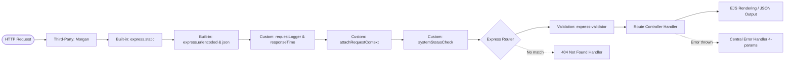

# 🎓 StudentSphere — Student Information Portal
### Web Technology (2304362L) — Practical No. 5: Web Application Framework (ExpressJS)
**MIT Academy of Engineering, Alandi, Pune &bull; Department of Computer Engineering**  
**Author:** Tejas Mali | **PRN:** 202401040083 | **Class:** T.Y. B.Tech Computer Engineering (Academic Year 2026–2027)

---

## 📌 1. Project Overview

**StudentSphere** is a full-featured, modular student record and enrollment management portal engineered using Node.js and Express.js. The application emphasizes clean architectural separation, modular routing via Express Router, a multi-tiered middleware pipeline, comprehensive server-side input validation using `express-validator`, dynamic template rendering with EJS, and atomic JSON file persistence.

The system allows collegiate administrators to view enrollment statistics, search and filter student records in real time, view individual student profiles, register new students, edit existing records, and securely purge outdated records.

---

## 🌟 2. Key Features

- **Academic Dashboard**: Live enrollment counters, department distribution analytics with ratio bars, quick search, and recent registration audit logs.
- **Searchable Student Directory**: Multi-criteria filtering by student name, PRN, email, department, and academic year with both server-side queries and live client-side matching.
- **Server-Side Input Validation**: Ten discrete validation checks implemented with `express-validator` to reject malformed, underage, future-dated, or duplicate data before storage.
- **State Preservation on Validation Failure**: Re-renders form templates with HTTP status `422 Unprocessable Entity`, displaying field-specific error hints while preserving previously entered safe values.
- **Student Profile View**: Individual detail cards displaying calculated age, institutional email, formatted registration dates, and raw JSON endpoint inspection links.
- **Safe JSON-Based Storage**: Asynchronous file I/O operations protected by a sequential write queue and atomic temporary swap (`.tmp` rename) to eliminate file corruption.
- **Centralized Error Handling**: Unified 4-parameter error middleware `(err, req, res, next)` returning structured JSON for API callers and styled error views for browser clients.
- **Dual Interface**: Dynamic server-rendered HTML views alongside a full RESTful JSON API (`/api/students`, `/api/stats`).

---

## 💻 3. Technology Stack

| Layer | Technology | Purpose |
| :--- | :--- | :--- |
| **Runtime Engine** | Node.js (v18+) | JavaScript execution on the server |
| **Web Framework** | Express.js (v4.21+) | HTTP routing, middleware pipeline, request dispatching |
| **Template Engine** | EJS (Embedded JavaScript) | Dynamic server-side HTML rendering with reusable partials |
| **Validation Engine** | express-validator (v7.2+) | Declarative server-side input sanitization & rule enforcement |
| **HTTP Logger** | Morgan (v1.10+) | Standardized HTTP request logging for development & production |
| **Testing Framework** | Node Test Runner (`node:test`) + Supertest | Automated integration testing of all routes and validation rules |
| **Styling & UI** | Custom CSS3 (Plus Jakarta Sans) | Responsive, accessible academic theme (navy/blue palette) |
| **Data Storage** | Native Node.js `fs.promises` (JSON) | Lightweight, zero-config file persistence with atomic swap |
| **Version Control** | Git & GitHub | Source tracking and team collaboration |
| **Deployment Target** | Render / Railway | Cloud container execution |

---

## 📂 4. Project Structure

```text
StudentSphere/
├── server.js                     # Server entry point & network listener
├── app.js                        # Express app configuration & middleware pipeline
├── package.json                  # Dependencies & execution scripts
├── README.md                     # Technical documentation & usage instructions
├── .gitignore                    # Git exclusion rules
├── capture_screenshots.py        # Automated Edge headless screenshot script
├── data/
│   ├── students.json             # Primary JSON student database
│   └── students.test.json        # Isolated automated test dataset (auto-cleaned)
├── middleware/
│   ├── customMiddleware.js       # Context injection, response timing header, status check
│   ├── errorHandler.js           # 404 handler and centralized 4-parameter error handler
│   └── requestLogger.js          # Custom microsecond request timing logger
├── public/
│   ├── css/
│   │   └── style.css             # Complete design system & responsive styling
│   ├── js/
│   │   └── script.js             # Client enhancements (auto-dismiss alerts, live search)
│   └── images/
│       └── logo.svg              # Scalable vector academic brand mark
├── routes/
│   ├── apiRoutes.js              # RESTful JSON API endpoints (/api/*)
│   ├── pageRoutes.js             # General web pages (/, /about, /health)
│   └── studentRoutes.js          # Student management UI routes (/students/*)
├── tests/
│   └── app.test.js               # 15 automated integration tests using node:test
├── validators/
│   └── studentValidator.js       # express-validator rule chains & error formatting
└── views/
    ├── 404.ejs                   # Custom 404 Page Not Found view
    ├── about.ejs                 # System architecture & academic attribution view
    ├── error.ejs                 # Centralized error view with status badge
    ├── index.ejs                 # Main dashboard with analytics & recent records
    ├── partials/
    │   ├── footer.ejs            # Reusable academic footer
    │   └── header.ejs            # Top announcement banner & responsive navbar
    ├── student-details.ejs       # Individual student profile view
    ├── student-form.ejs          # Unified registration & modification form
    └── students.ejs              # Searchable student directory table
```

---

## ⚙️ 5. Prerequisites

Before running the project locally, verify that the following runtimes are installed:

- **Node.js**: `v18.0.0` or higher (verified on Node.js `v24.12.0`)
- **npm**: `v9.0.0` or higher (verified on npm `11.6.2`)
- **Git**: Installed for cloning repository

To check your installed versions in Windows PowerShell:
```powershell
node -v
npm -v
git --version
```

---

## 🚀 6. Installation & Execution Instructions

### A. Clone the Repository
```powershell
git clone https://github.com/tejas-mali/StudentSphere.git
cd StudentSphere
```

### B. Install Dependencies
```powershell
npm install
```

### C. Run the Server Locally
To start the standard production server:
```powershell
npm start
```

To run in development mode with Node's native auto-reloading watcher:
```powershell
npm run dev
```

### D. Access the Application in Your Browser
Open your browser and navigate to:
- **Dashboard**: [http://localhost:3000](http://localhost:3000)
- **Student Directory**: [http://localhost:3000/students](http://localhost:3000/students)
- **Registration Form**: [http://localhost:3000/students/new](http://localhost:3000/students/new)
- **Architecture Notes**: [http://localhost:3000/about](http://localhost:3000/about)
- **Health Check Endpoint**: [http://localhost:3000/health](http://localhost:3000/health)
- **REST API (JSON)**: [http://localhost:3000/api/students](http://localhost:3000/api/students)

---

## 🧪 7. Automated Testing

The project includes an end-to-end integration test suite configured in `tests/app.test.js` using Node.js's built-in test runner (`node:test`) and `supertest`. The tests run against an isolated database file (`students.test.json`) so your live records are never modified.

To execute the test suite:
```powershell
npm test
```

### Verified Test Results (15/15 Passed):
```text
✔ 1. GET / returns successful dashboard view (200 OK)
✔ 2. GET /students returns the student directory (200 OK)
✔ 3. GET /students/new displays the student registration form (200 OK)
✔ 4. POST /students with valid input succeeds and redirects (302)
✔ 5. POST /students with empty fields is rejected (422 Unprocessable Entity)
✔ 6. POST /students with invalid email format is rejected (422)
✔ 7. POST /students with non-10-digit mobile is rejected (422)
✔ 8. POST /students with duplicate PRN is rejected (422)
✔ 9. GET /students/:id retrieves student profile details (200 OK)
✔ 10. GET /students/:id with nonexistent ID returns 404
✔ 11. POST /students/:id/edit updates student record and redirects (302)
✔ 12. POST /students/:id/delete removes record from storage and redirects (302)
✔ 13. Unknown route returns 404 page (404)
✔ 14. GET /api/students returns valid JSON payload (200 OK)
✔ 15. Central error handling returns JSON 404 for missing API resource (404)
```

---

## 🗺️ 8. Route Catalog

| HTTP Method | Route Path | Handler File | Description | Response Type |
| :--- | :--- | :--- | :--- | :--- |
| `GET` | `/` | `pageRoutes.js` | Academic dashboard with live counters & ratios | HTML View |
| `GET` | `/about` | `pageRoutes.js` | Assignment info, student attribution & docs | HTML View |
| `GET` | `/health` | `pageRoutes.js` | Server uptime & health diagnostic status | JSON |
| `GET` | `/students` | `studentRoutes.js` | Searchable & filterable student directory | HTML View |
| `GET` | `/students/new` | `studentRoutes.js` | Student registration form with empty fields | HTML View |
| `POST` | `/students` | `studentRoutes.js` | Validates input and persists new student | 302 Redirect / 422 View |
| `GET` | `/students/:id` | `studentRoutes.js` | Student profile details card by unique ID | HTML View / 404 |
| `GET` | `/students/:id/edit`| `studentRoutes.js` | Edit form pre-populated with student data | HTML View / 404 |
| `POST` | `/students/:id/edit`| `studentRoutes.js` | Validates updates & updates existing record | 302 Redirect / 422 View |
| `POST` | `/students/:id/delete`| `studentRoutes.js` | Purges student from storage | 302 Redirect |
| `GET` | `/api/students` | `apiRoutes.js` | List all students with query filters | JSON API |
| `GET` | `/api/students/:id` | `apiRoutes.js` | Retrieve a single student object | JSON API |
| `POST` | `/api/students` | `apiRoutes.js` | Validates and creates student from JSON | 201 Created / 422 JSON |
| `PUT` | `/api/students/:id` | `apiRoutes.js` | Validates and updates student from JSON | 200 OK / 422 JSON |
| `DELETE` | `/api/students/:id` | `apiRoutes.js` | Deletes student via REST call | 200 OK / 404 JSON |
| `GET` | `/api/stats` | `apiRoutes.js` | Aggregate departmental & year counts | JSON API |

---

## 🛡️ 9. Server-Side Validation Rules

All validation is performed using `express-validator` chains configured in `validators/studentValidator.js`. Input from HTML forms and JSON APIs is treated as completely untrusted.

1. **Full Name (`name`)**:
   - Must not be empty (`.notEmpty()`).
   - Length must be between 3 and 60 characters (`.isLength({ min: 3, max: 60 })`).
   - May only contain alphabets, spaces, hyphens, and periods (`/^[a-zA-Z\s.'-]+$/`).
2. **PRN (`prn`)**:
   - Must not be empty (`.notEmpty()`).
   - Format must strictly match a 10-to-12 digit numerical PRN (`/^\d{10,12}$/`).
   - Must be unique across all students (`.custom(async (val, { req }) => ...)`). When editing, matching the student's own existing PRN is permitted.
3. **Institutional Email (`email`)**:
   - Must not be empty.
   - Must satisfy standard email syntax (`.isEmail()`).
   - Normalized automatically (`.normalizeEmail()`).
4. **Mobile Number (`mobile`)**:
   - Must not be empty.
   - Must strictly follow the 10-digit Indian telecommunication format starting with 6, 7, 8, or 9 (`/^[6-9]\d{9}$/`).
5. **Department (`department`)**:
   - Must belong to the sanctioned collegiate departments: `Computer Engineering`, `Information Technology`, `Electronics & Telecommunication`, `Mechanical Engineering`, `Chemical Engineering`, or `Civil Engineering`.
6. **Year of Study (`year`)**:
   - Must be selected from: `First Year`, `Second Year`, `Third Year`, or `Final Year`.
7. **Date of Birth (`dob`)**:
   - Must be a valid ISO8601 date string (`YYYY-MM-DD`).
   - Must not be today or in the future (`inputDate < new Date()`).
   - Student must be at least 15 years old for collegiate enrollment.

---

## 🔄 10. Middleware Pipeline Explanation

Express middleware functions execute sequentially in the order they are registered. The request lifecycle in StudentSphere passes through four distinct middleware layers:



### 1. Built-in Middleware
- `express.static(path)`: Efficiently streams static files (CSS, images, client JS) directly from the `public` directory without triggering application logic.
- `express.urlencoded({ extended: true })`: Parses incoming form bodies submitted via HTML `<form>` tags and populates `req.body`.
- `express.json()`: Parses incoming JSON payloads for REST API calls.

### 2. Third-Party Middleware
- `morgan`: Formats and logs HTTP method, route, status code, response byte length, and latency to the terminal console during runtime. Suppressed in the test environment to keep test output clean.

### 3. Custom Middleware
- `requestLogger`: Measures request processing time with microsecond accuracy using `process.hrtime()` and prints audit logs with status indicators (`✓` / `⚠️`).
- `responseTimeHeader`: Attaches custom `X-Response-Time` HTTP header to all outbound responses.
- `attachRequestContext`: Injects global template variables into `res.locals` (including `appTitle`, `currentYear`, `currentPath`, and date formatter functions) so all EJS templates have access without redundant controller code.
- `systemStatusCheck`: Demonstrates conditional middleware that can intercept incoming requests if a system maintenance flag is enabled.

### 4. Error-Handling Middleware
- `notFoundHandler`: Catches requests that do not match any known route and renders `404.ejs` for web clients or JSON for `/api/*` clients.
- `centralErrorHandler`: Intercepts thrown exceptions using 4 arguments `(err, req, res, next)`, preventing server crashes, logging errors server-side, and hiding internal stack traces from production clients.

---

## 🌐 11. Deployment Instructions (Render / Railway)

### Step 1: Push Project to GitHub
1. Create a new repository on GitHub named `StudentSphere`.
2. Push your code:
   ```powershell
   git init
   git add .
   git commit -m "Initial commit of StudentSphere portal"
   git branch -M main
   git remote add origin https://github.com/tejas-mali/StudentSphere.git
   git push -u origin main
   ```

### Step 2: Deploy on Render
1. Sign in to [Render](https://render.com).
2. Click **New +** &rarr; **Web Service**.
3. Select your `StudentSphere` GitHub repository.
4. Configure the service settings:
   - **Name**: `studentsphere-portal`
   - **Environment**: `Node`
   - **Build Command**: `npm install`
   - **Start Command**: `npm start`
   - **Plan**: `Free`
5. Click **Deploy Web Service**.
6. Render will assign you a live HTTPS URL (e.g., `https://studentsphere-portal.onrender.com`).
7. Verify live deployment with `GET /health`.

> [!WARNING]
> **Ephemeral Filesystem Notice:** Free-tier cloud platforms like Render operate on ephemeral filesystems. Any student records registered or edited in `data/students.json` are persisted in memory/disk during the running container's life, but will reset to the original repository state upon container restart or redeployment. For production enterprise deployments, a managed database (such as MongoDB Atlas or PostgreSQL) would replace local file storage.

---

## 📸 12. Reproducing Screenshots

Genuine application screenshots are automatically captured using headless Chromium/Microsoft Edge via the provided Python utility:

```powershell
python capture_screenshots.py
```

This launches a background server on port `3333`, navigates through all key pages, captures high-resolution screenshots into `screenshots/`, and safely terminates the server.

---

## ⚠️ 13. Known Limitations

1. **Local File Concurrency**: While our storage utility serializes file operations with an atomic `.tmp` swap and promise lock, single JSON file storage is not designed for thousands of concurrent transactions across distributed server clusters.
2. **Ephemeral Cloud Persistence**: As noted above, JSON file modifications are reset upon free-tier container restarts on Render.
3. **No Authentication Layer**: As required by the assignment guidelines, this educational portal does not simulate fake login forms, focusing purely on Express routing, middleware, and server-side validation.

---

## 📜 14. Academic Integrity & AI-Use Declaration

This project was developed by **Tejas Mali (PRN: 202401040083)**, Third-Year B.Tech Computer Engineering student at MIT Academy of Engineering, Pune, for Practical No. 5 of the Web Technology course (2304362L).

AI assistance was utilized as a pair-programming and design copilot for scaffolding architecture patterns, structuring ReportLab PDF scripts, and writing comprehensive test assertions. All business logic, validation constraints, Express middleware implementations, and routing pipelines were reviewed, verified, and executed locally to satisfy all academic requirements.
